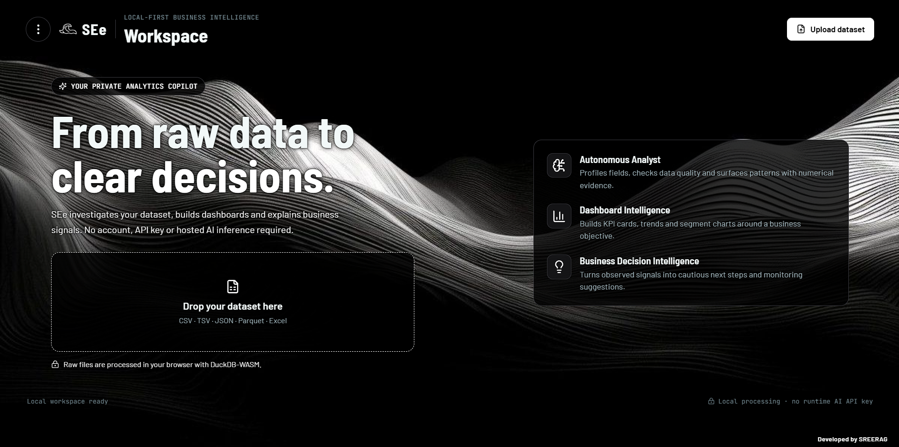
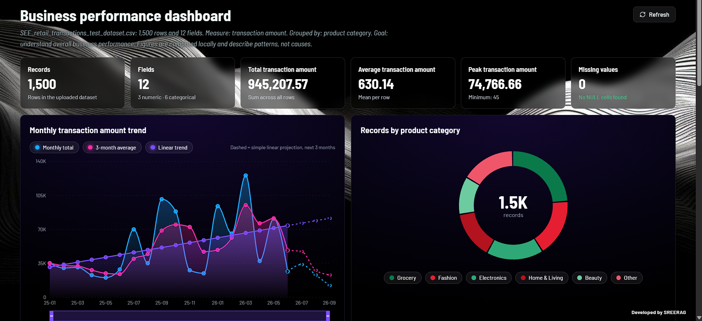
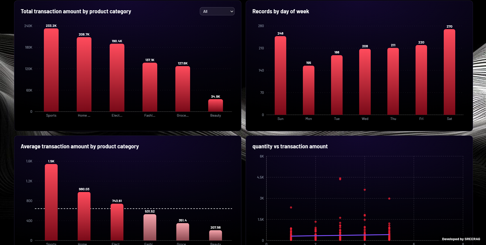
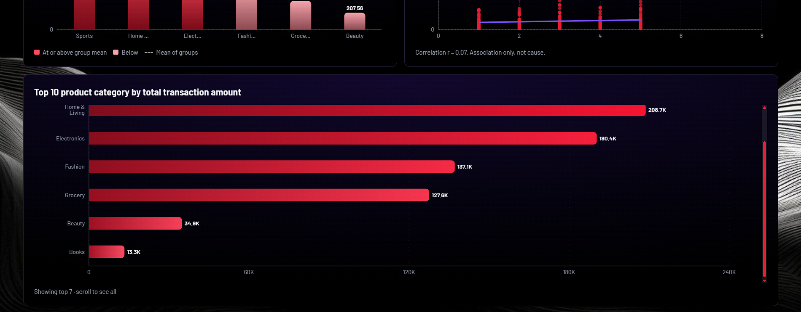
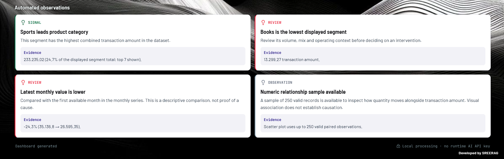
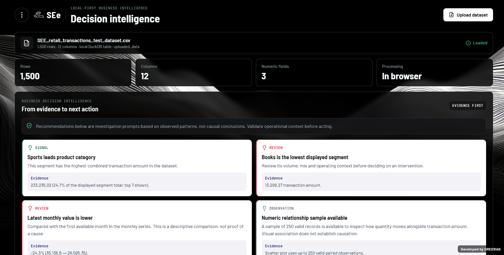
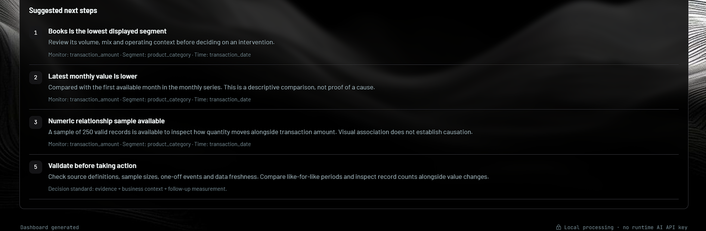
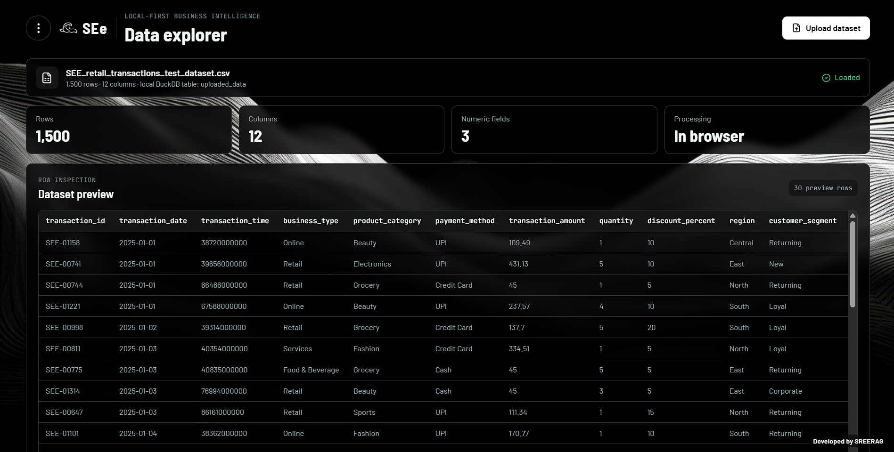
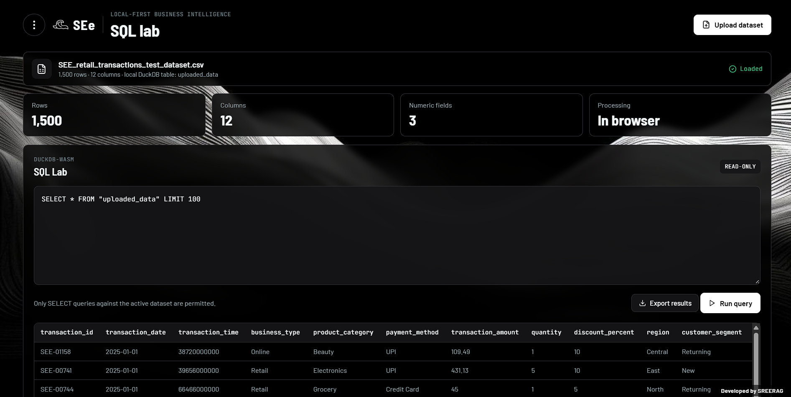
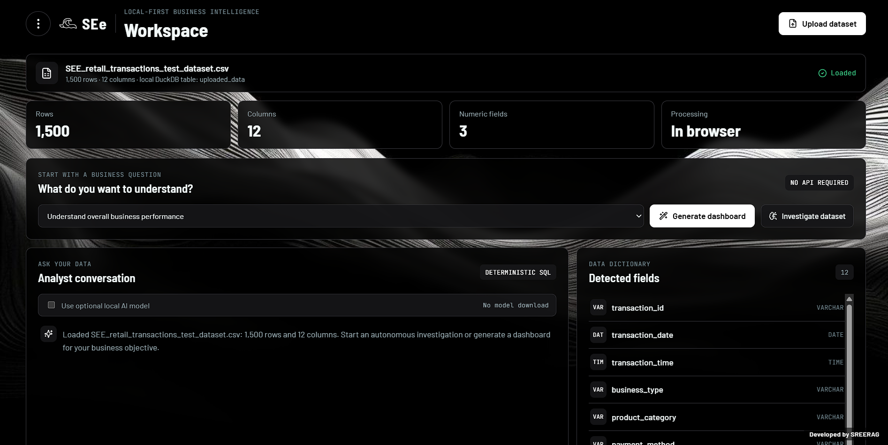

# SEe


**A local-first, browser-based data analysis workspace.** Upload a dataset, let SEe investigate it, and get a dashboard and evidence-backed observations in seconds. No account, no API key and no hosted AI inference needed.

Your data is processed in the browser with DuckDB-WASM and is never sent to an application backend.

---

## Features

- **Autonomous Analyst:** profiles every field, checks for NULLs, flags identifier-like columns, compares months and ranks segments with numerical evidence.
- **Dashboard Intelligence:** six KPI cards plus interactive charts:
  - monthly trend with a 3-month average, a linear trend and a dashed 3-month projection
  - green and red donut of records by category
  - column charts for totals, day-of-week patterns and averages against the group mean
  - scatter plot with a correlation reading
  - scrollable Top 10 chart with red gradient bars
- **Decision Intelligence:** evidence cards and cautious next steps. It separates descriptive observations from causes and never claims that correlation proves cause.
- **Data Explorer:** preview the loaded rows and detected fields.
- **SQL Lab:** run read-only `SELECT` queries on your data and export results to CSV.
- **Analyst chat:** ask questions in plain language. A rule-based planner writes the SQL, and an optional local WebLLM model is available.
- **File formats:** CSV, TSV, JSON, JSONL/NDJSON, Parquet, XLSX and XLS (first worksheet).

---

## Screenshots

### 1. Workspace: drop in a dataset



### 2. Dashboard: KPIs, monthly trend and records by category



### 3. Interactive column charts and scatter plot



### 4. Average vs. group mean and the scrollable Top 10



### 5. Automated observations



### 6. Decision intelligence: from evidence to next action



### 7. Suggested next steps



### 8. Data explorer



### 9. SQL Lab



### 10. Workspace: analyst conversation and detected fields



---

## Try it with the sample data

`Test_Data/SEE_retail_transactions_test_dataset.csv` is a sample retail transactions file with 1,500 rows and 12 columns. Upload it to see every screen above.

---

## Run locally

Requirements: Node.js 20+ and npm.

```bash
cd SEe-data-intelligence
npm install
npm run dev
```

Production build:

```bash
npm run build
```

---

## Deploy

The app is static, so it deploys to Netlify or Vercel without a server. The app lives in the `SEe-data-intelligence/` folder, so set that as the **root / base directory** when importing the repository.

| Setting | Value |
| --- | --- |
| Root / base directory | `SEe-data-intelligence` |
| Build command | `npm run build` |
| Output directory | `dist` |
| Node version | 20 |

The repository includes a `netlify.toml` inside `SEe-data-intelligence/`.

---

## Privacy

- Uploaded data is loaded into DuckDB-WASM in your browser and is not uploaded to an application backend.
- The DuckDB engine files are downloaded from jsDelivr on first load, so the first visit needs an internet connection.
- The local AI model is optional. It runs in the browser via WebGPU, and its model files are downloaded on first use. The core analysis works without it.

---

## Limits

SEe is an MVP, not a certified reporting system.

- Field selection (metric, date, category) is heuristic. Check it against your data dictionary.
- Missing-value checks count SQL NULLs, not every blank-string convention.
- Trends and projections are descriptive. The dashed projection is a simple linear extrapolation, not a forecasting model.
- Observations suggest what to investigate, not what action is guaranteed to work.
- Very large files depend on your device's browser memory.

---

## Tech stack

React, TypeScript, Vite, DuckDB-WASM, Recharts, PapaParse, SheetJS, WebLLM, Lucide.

---

## License

MIT. See [`SEe-data-intelligence/LICENSE`](SEe-data-intelligence/LICENSE).

## Developed By

SREERAG
BCA Data Science Graduate

- **GitHub:** [@sreeragsrinu](https://github.com/sreeragsrinu)
- **LinkedIn:** [Sreerag S](https://www.linkedin.com/in/sreerag-s-9b25162a7/)
- **Portfolio:** [sreeragportfolio.netlify.app](https://sreeragportfolio.netlify.app)
- **Email:** [sreeragsrinuu@gmail.com](sreeragsrinuu@gmail.com)

---
